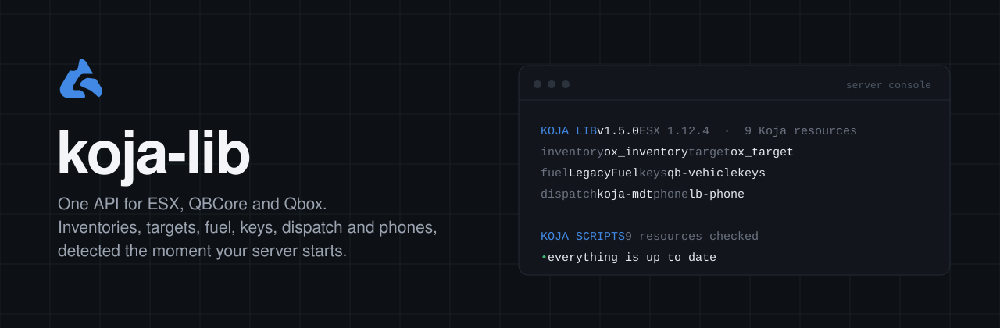
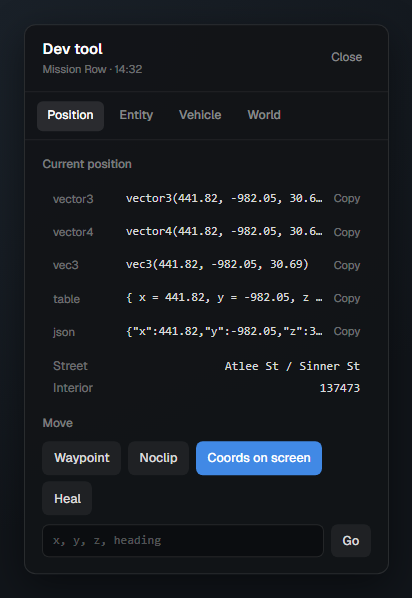

<div align="center">



<br>

[](https://github.com/Koja-Scripts/koja-lib/releases/latest)
[](https://github.com/Koja-Scripts/koja-lib/releases)
[](https://github.com/Koja-Scripts/koja-lib/actions/workflows/release.yml)


<a href="https://github.com/Koja-Scripts/koja-lib/releases/latest/download/koja-lib.zip"></a>

[Documentation](https://docs.kojascripts.com/koja-lib/getting-started) · [Releases & versions](https://versions.kojascripts.com) · [Discord](https://discord.gg/kojascripts) · [Report a bug](https://github.com/Koja-Scripts/koja-lib/issues)

</div>

---

koja-lib is the shared library behind every Koja Scripts resource. Write a script once and it runs on **ESX**, **QBCore** and **Qbox**, with whatever inventory, target, fuel, key, dispatch or phone resource the server happens to use. Everything is detected on start and can be forced in one config file.

## Contents

- [Installation](#installation)
- [What you get](#what-you-get)
- [Supported resources](#supported-resources)
- [Startup console](#startup-console)
- [Dev tool](#dev-tool)
- [Quick look](#quick-look)
- [API overview](#api-overview)
- [For script authors: version checks](#for-script-authors-version-checks)

## Installation

1. Download **[koja-lib.zip](https://github.com/Koja-Scripts/koja-lib/releases/latest/download/koja-lib.zip)** from the latest release. The UI is already built.
2. Extract it into your `resources` folder. The folder must be named `koja-lib`.
3. Start it after your framework and `oxmysql`:

```cfg
ensure oxmysql
ensure es_extended   # or qb-core / qbx_core
ensure koja-lib
```

> [!WARNING]
> Don't use *Code → Download ZIP* or *Source code (zip)*. That is the raw source without the built UI (`web/build`).

## What you get

| | |
|---|---|
| **One API, three frameworks** | ESX, QBCore and Qbox behind the same function names, plus a custom bridge for anything else. |
| **Integrations that find themselves** | Inventory, target, fuel, vehicle keys, banking, clothing, notifications, dispatch and phones are picked up on start. |
| **UI kit** | Progress bar, text UI, notifications, DUI textures and a 3D sound player, all from Lua. |
| **Gameplay helpers** | Points with enter and exit callbacks, rebindable keybinds, awaitable callbacks, stashes, usable items, cooldowns and webhooks. |
| **Dev tool** | `/kojadev`: coordinates in every format, an entity inspector, noclip, vehicle and world helpers. |
| **Version checks** | One report for every Koja resource on the server and a private page with changelogs. |

## Supported resources

Every category is set to `'auto'` in `editable/shared/config.lua`. The detection order lives in `editable/shared/integrations.lua`, so you can reorder it or add your own fork.

| Category | Resources |
|---|---|
| Framework | `es_extended` · `qb-core` · `qbx_core` · custom |
| Inventory | `ox_inventory` · `qb-inventory` and its forks · `codem-inventory` · `jaksam_inventory` · custom |
| Target | `ox_target` · `qb-target` · `qtarget` · `koja-interactions` |
| Fuel | `ox_fuel` · `Renewed-Fuel` · `LegacyFuel` · `cdn-fuel` · `ps-fuel` · `lc_fuel` · `qs-fuelstations` · `okokGasStation` · `lj-fuel` · `ti_fuel` · native |
| Vehicle keys | `qbx_vehiclekeys` · `qb-vehiclekeys` · `wasabi_carlock` · `mk_vehiclekeys` · `MrNewbVehicleKeys` · `qs-vehiclekeys` · `Renewed-Vehiclekeys` · `cd_garage` · `okokGarage` |
| Dispatch | `koja-mdt` · `koja-dispatch` · `ps-dispatch` · `cd_dispatch` · `core_dispatch` · `rcore_dispatch` · `qs-dispatch` |
| Phone | `lb-phone` · `qs-smartphone` · `qs-smartphone-pro` · `gksphone` · `qb-phone` |
| Notifications | framework · `ox_lib` · `okokNotify` · `mythic_notify` · `pNotify` · built-in |
| Banking / society | `Renewed-Banking` · `okokBanking` · `qb-banking` · `qb-management` · `esx_society` |
| Clothing | `illenium-appearance` · `fivem-appearance` · `qb-clothing` · `skinchanger` |
| Sound | `xsound` · built-in NUI player |

Every call into another resource is wrapped in `pcall`, so a broken or outdated integration never takes koja-lib down with it.

## Startup console

koja-lib prints one compact block when it starts. It shows what it found and, a few seconds later, whether your Koja Scripts are up to date:

```text
────────────────────────────────────────────────────────────────
  KOJA LIB  v1.5.0   ESX 1.12.4   ·   9 Koja resources
  inventory ox_inventory          target    ox_target             notify    esx
  fuel      LegacyFuel            keys      qb-vehiclekeys        banking   esx_society
  clothing  illenium-appearance   dispatch  koja-mdt              phone     lb-phone
────────────────────────────────────────────────────────────────
  KOJA SCRIPTS  9 resources checked
  • everything is up to date
  versions & changelogs  https://versions.kojascripts.com/s/k4m9x2p7q3vd
```

The link opens a private page for your server with installed and latest versions and the changelog for each script. Turn it off with `Config.VersionCheck.enabled = false`.

## Dev tool



Type `/kojadev` in game. Admins only, following the `Config.Admin` rules.

- **Position:** copy the current spot as `vector3`, `vector4`, `vec3`, a Lua table or JSON. Teleport to the waypoint or to typed coordinates, noclip, and coordinates on screen.
- **Entity:** aim at a ped, vehicle or object and press <kbd>E</kbd> to read its model, hash, coordinates, rotation and net id.
- **Vehicle:** spawn by model with fuel and keys, then repair, refuel, flip, give keys or delete.
- **World:** set or freeze the time and change the weather for yourself only, or clear the area.

Settings live in `Config.DevTool`: command name, an optional key mapping, and extra ACE or groups.

<br clear="right">

## Quick look

```lua
local job = KOJA.Server.GetPlayerJob(source)

if job.name == 'police' and KOJA.Server.HasItem(source, 'handcuffs') then
    KOJA.Server.addMoney(source, 500, 'cash')
    KOJA.Server.SendNotify({ source = source, type = 'success', desc = 'Bonus paid.' })
end
```

Send a dispatch alert to whatever dispatch the server runs:

```lua
KOJA.Server.SendDispatch({
    source = source,
    code = '10-90',
    title = 'Store robbery',
    message = 'Silent alarm at the 24/7 on Innocence Blvd',
    jobs = { 'police' },
    priority = 1,
    blip = { sprite = 52, color = 1 },
})
```

Mail a player on their phone, or fall back to a notification:

```lua
KOJA.Server.SendPhoneMail(source, { sender = 'Mechanic', subject = 'Your car is ready', message = 'Pick it up at the Burton shop.' })
```

## API overview

Get the object with `KOJA = exports['koja-lib']:getSharedObject()` or load `@koja-lib/init.lua`.

<details>
<summary><b>Server</b></summary>

- **Players and jobs:** `GetPlayerJob`, `GetJobInfo`, `SetJob`, `SetOfflineJob`, `SetJobDuty`, `GetJobs`, `GetPlayersByJob`, `NotifyJob`, `GetSourceByIdentifier`, `GetGender`, `IsAdmin(src, groups, ace, identifiers)`
- **Money:** `addMoney`, `removeMoney`, `ChargePlayer(src, amount, accounts, reason)`, `SyncSocietyBalance`
- **Items:** `addInventoryItem`, `removeInventoryItem`, `getInventoryItemCount`, `HasItem`, `CanCarryItem`, `GetItemsByName`, `GetItemList`, `GetItemLabel`, `GetItemImage`, `RegisterUsableItem`
- **Stashes:** `RegisterStash`, `OpenStash`, `AddStashItem`, `RemoveStashItem`, `GetStashItems`, `GetStashItemCount`
- **Vehicles:** `GiveVehicleKeys(src, plate, netId)`, `RemoveVehicleKeys(src, plate, netId)`
- **Dispatch:** `SendDispatch(data)`, `GetDispatchResource()`
- **Phone:** `SendPhoneNotification(src, data)`, `SendPhoneMail(src, data)`, `GetPhoneResource()`
- **Utilities:** `SendNotify`, `Cooldown`, `ResetCooldown`, `LogMessage(data, hook)`
- **Versions:** `GetVersionReport()`, `GetVersionStatus(resource)` and the `koja-lib:versions:ready` event

</details>

<details>
<summary><b>Client</b></summary>

- **Callbacks:** `AwaitServerCallback(key, payload, timeoutMs)`
- **UI:** `Progress(data)`, `CancelProgress()`, `IsProgressActive()`, `ShowTextUI(data)`, `HideTextUI()`, `SendNotify(data)`
- **Vehicles:** `GetVehicleProperties`, `SetVehicleProperties`, `GetClosestVehicle`, `GetFuel`, `SetFuel`, `GetFuelResource`, `GiveVehicleKeys`, `RemoveVehicleKeys`
- **Target:** `Target.GetName()`, `Target.AddSphere`, `Target.AddBox`, `Target.Remove`, `Target.AddLocalEntity`, `Target.RemoveLocalEntity`
- **Clothing:** `Clothing.GetAppearance`, `Clothing.ApplyOutfit`, `Clothing.RestoreCivilian`
- **Dispatch:** `SendDispatch(data)`. It goes through the server, with a cooldown, a distance check and the jobs from `Config.Dispatch`.
- **Other:** `OpenStash(id)`, `RequestModel`, `RequestAnimDict`, `GetGender`, `Sound.*`

</details>

<details>
<summary><b>Custom framework or inventory</b></summary>

Override hooks live in `editable/custom/framework_server.lua` (`GetJobInfo`, `SetJob`, `SetOfflineJob`, `SetJobDuty`, `GetJobs`, `GetSourceByIdentifier`, `GetGender`, `IsGroupAdmin`, `RegisterUsableItem`) and `editable/custom/inventory_server.lua` (`CanCarryItem`, `GetItemsByName`, `GetItemList` and the stash hooks).

With ox_inventory, a usable item needs `consume = 0` so ox fires `ox_inventory:usedItem`, or `server = { export = 'koja-lib.useItem' }`.

</details>

Full reference: **[docs.kojascripts.com](https://docs.kojascripts.com/koja-lib/getting-started)**.

## For script authors: version checks

Any started resource whose fxmanifest `author` contains "Koja" is included in the server's version report. Two optional fields help with forks and renamed folders:

```lua
koja_resource 'koja-hud-free'   -- the repository name, used even if the folder is renamed
koja_version '1.0.9'            -- your own version when `version` must stay at the upstream number
```

<details>
<summary><b>Publishing a release (maintainers)</b></summary>

1. Bump `version` in `fxmanifest.lua`, add a `## [x.y.z]` section to `CHANGELOG.md` and push to `main`.
2. Push a matching tag (`git tag -a 1.5.0 -m "koja-lib 1.5.0" && git push origin 1.5.0`), or run the **Release** workflow from the Actions tab. It builds the UI, packages `koja-lib.zip` and publishes the release with the changelog section.

</details>

---

<div align="center">
<sub><b>Koja Scripts</b> · <a href="https://kojascripts.com">kojascripts.com</a> · if koja-lib saves you time, a star helps</sub>
</div>
